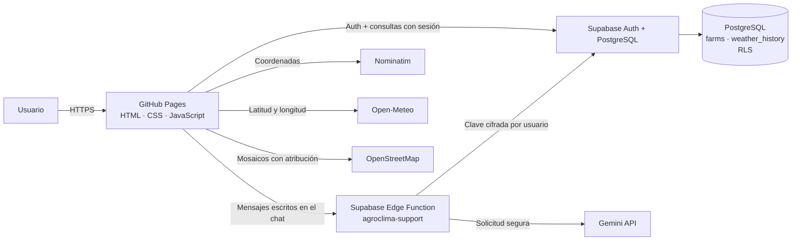

# Arquitectura y demostración

## Responsabilidad de cada parte

| Parte | Responsabilidad |
| --- | --- |
| HTML, CSS y JavaScript | Interfaz, formularios, mapa, consulta de API, comparación con umbrales y visualización del historial. |
| GitHub Pages | Publica archivos estáticos mediante HTTPS; no ejecuta código privado de servidor. |
| Supabase Auth | Registra e identifica al usuario, confirma su correo y mantiene la sesión. |
| Supabase PostgreSQL | Almacena terrenos, reglas de alerta e historial meteorológico; RLS separa datos por usuario. |
| Supabase Edge Functions | Cifra las claves de Gemini por cuenta y llama a Gemini sin exponerlas al navegador. El asistente solo recibe los mensajes escritos por el usuario. |
| Gemini | Responde preguntas de soporte sobre el uso de AgroClima; no recibe automáticamente el historial ni la ubicación de los terrenos. |
| Open-Meteo | Proporciona datos de pronóstico por coordenadas. |
| Nominatim | Convierte coordenadas seleccionadas en una localidad aproximada. |
| Leaflet + OpenStreetMap | Muestra el mapa y los marcadores de los terrenos registrados. |

## Flujo de la demostración obligatoria

1. El usuario crea una cuenta y entra con Supabase Auth.
2. Registra manualmente el terreno de café de Oxapampa que se usará en la exposición. No hay terrenos de ejemplo precargados.
3. La página solicita el pronóstico para esas coordenadas a Open-Meteo.
4. El frontend evalúa cada fecha con los umbrales guardados para ese terreno: precipitación mayor que 20 mm, viento mayor que 50 km/h, mínima menor que 5 °C y máxima mayor que 35 °C.
5. Se presenta la alerta si al menos una condición se cumple; de lo contrario, se muestra que el pronóstico está dentro de los límites.
6. La aplicación inserta en `weather_history` las siete fechas consultadas. La política RLS verifica que el usuario y terreno correspondan a la sesión.
7. Historial consulta filas guardadas y muestra fecha de consulta, fecha prevista, temperatura, lluvia, humedad y viento.

## Datos y límites de las APIs

- El pronóstico usa las variables diarias temperatura máxima y mínima, precipitación acumulada, viento máximo y código meteorológico. La humedad es el promedio de las observaciones horarias del día.
- Los datos dependen del proveedor y del pronóstico disponible para las coordenadas. La precipitación futura no es una observación medida en el terreno.
- El geocodificador se usa solo para coordenadas puntuales, no para autocompletar texto. El código espera al menos un segundo entre peticiones en una sesión de navegador.
- Los mosaicos muestran la atribución de OpenStreetMap. Respetar las políticas de uso y cuotas del servicio.
- La app requiere Internet para autenticación, clima, mapa y geocodificación.

## Guion breve de exposición

1. Explicar que la consulta manual de clima en varias regiones dificulta anticipar eventos y planificar labores.
2. Registrar manualmente la finca de café de Oxapampa y mostrar sus datos, ubicación en el mapa y cultivo.
3. Consultar Open-Meteo y explicar las unidades de cada variable.
4. Mostrar la regla de umbral y señalar qué día activa la alerta, si el pronóstico actual la supera.
5. Abrir Historial y mostrar las filas guardadas en Supabase.
6. Explicar RLS: una sesión solo puede operar sobre sus terrenos y el historial de esos terrenos.

El usuario puede configurar o quitar su clave de Gemini desde `integrations.html`. Open-Meteo, Nominatim, Leaflet y Chart.js no requieren claves para esta implementación.

