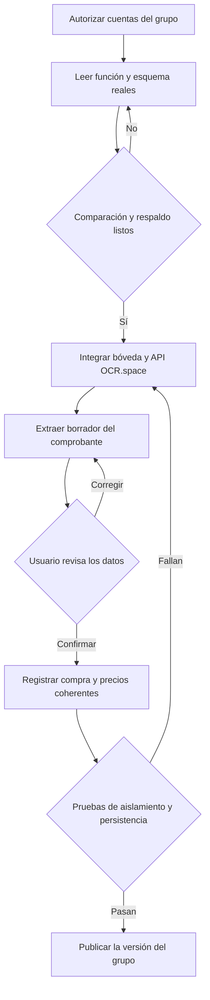

# CompraSmart AI: auditoría y recuperación

Fecha de referencia: 3 de noviembre de 2026. Repositorio principal: https://github.com/amadorjara-alt/CompraSmart-AI. Base examinada: `df3569c1d7b64ffa68a10d95e912e6ae0be529e6`.

## Estado real y accesos pendientes

Las correcciones de esta revisión se reúnen en la rama `codex/recuperacion-ocr-integraciones`. El bloqueo inicial **HTTP 403: Resource not accessible by integration** se resolvió después de que el propietario autorizara la conexión: se comprobó la creación de la rama remota en el repositorio de `amadorjara-alt`. Publicar la fuente no modifica la rama principal ni despliega las funciones de Supabase.

El proyecto que debe conservarse es **CompraSmart-AI**, referencia **fledooqwmwrjufeihoqn**, URL https://fledooqwmwrjufeihoqn.supabase.co. La conexión de Supabase disponible devolvió **You do not have permission to perform this action** al consultar ese proyecto. No se han realizado cambios en esa base, bucket, funciones, secretos ni políticas. No se sustituyó su Project URL ni su clave publicable.

Para continuar la integración completa falta facilitar acceso al proyecto Supabase indicado mediante la conexión de cuenta o membresía de organización. El permiso de GitHub ya está comprobado. No se necesitan contraseñas ni claves privadas en el chat.

## Comparación del ZIP y del repositorio

El ZIP adjunto contiene el proyecto principal y una implementación anterior en `OCR/`. Los HTML y el CSS del proyecto principal coinciden con la base examinada. GitHub contiene versiones distintas y más recientes de `auth.js`, `dashboard.js`, `integrations.js`, `main.js` y `supabase.js`. Se usa GitHub como base; no se sobrescribieron sus mejoras con el ZIP.

La implementación antigua incluye lectura de PDF con PDF.js, OCR local y llamadas a Gemini desde el navegador, extracción de RUC, fechas, números, importes, clasificación y revisión. Se recuperaron únicamente las funciones puras de extracción y validación. No se copiaron su almacenamiento local de claves ni sus llamadas a Gemini desde el navegador.

Se conserva una referencia local al original en `backup/original-df3569c`; el historial remoto original y el ZIP no se alteraron.

## Diagnóstico y correcciones preparadas

| Hallazgo comprobado en el código | Corrección local |
| --- | --- |
| Guardar o recuperar una credencial la marcaba como conexión verificada sin llamar al proveedor. | Estado `configured`, separado de `verified`, con mensaje de prueba pendiente. Se cuentan correctamente las integraciones configuradas. |
| El modal sustituía el modelo guardado por el predeterminado y obligaba a reintroducir la clave. | Se conserva el modelo recuperado. Un campo de clave vacío permite conservar el ciphertext y el IV existentes. |
| La función exigía una clave nueva incluso para modificar el modelo. | La actualización de metadatos no reescribe ni descifra el secreto guardado. Una integración nueva sigue requiriendo clave. |
| El backend ya permitía eliminar una credencial, pero faltaba una acción de usuario en el modal. | Botón de eliminación explícita con confirmación. Cerrar el modal o cerrar sesión no elimina la fila del servidor. |
| Dashboard e historial sumaban PEN y USD como soles y sumaban documentos fallidos o pendientes. | Totales separados por moneda, únicamente de documentos con estado `completed`. Los valores sin moneda se identifican y no se convierten a PEN. |
| Las fechas podían variar al interpretar un día ISO como UTC y mostrarlo en otra zona. | Fechas del comprobante conservadas; fechas de registro interpretadas en America/Lima para las series mensuales. |
| El gráfico temporal combinaba monedas y estados; la distribución de catálogo parecía gasto. | Series independientes por moneda, categoría identificada como cantidad de productos y gráfico de barras de estados. |
| Comparación usaba precios antiguos y mezclaba negocios del mismo usuario. | Solo referencias de facturas cargadas para el negocio actual, procesadas, de 30 días, con última referencia por proveedor y moneda. No se afirma stock ni precio vigente. |
| Un fallo de red o al actualizar el panel podía cambiar una factura ya procesada a `failed`. | El cliente deja de sobrescribir el estado administrado por el servidor por esos errores. |
| Modal sin desplazamiento garantizado y datos importantes truncados. | Desplazamiento del modal y ajuste de texto en los campos de perfil y referencias afectados. No se eliminan todas las reglas de truncamiento del tema. |

Los importes y las filas de los gráficos se derivan de las consultas existentes, no de cifras de demostración incorporadas al dashboard.

## Recuperación del OCR y API gratuita

`supabase/functions/_shared/receipt-parser.mjs` recupera el reconocimiento de proveedor, checksum del RUC, fecha y número de comprobante de la carpeta antigua. Corrige la coma decimal, formatos de miles y la confusión entre `SUB TOTAL` y `TOTAL`. No inventa impuestos, moneda o total cuando no se reconocen, y señala inconsistencias de importes.

`supabase/functions/_shared/ocr-space.mjs` implementa un adaptador real para **OCR.space**, motor 2: envío de PNG, JPG o PDF mediante POST, verificación de tamaño y firma del archivo, respuesta JSON, cuotas, errores HTTP, errores de procesamiento dentro de HTTP 200, timeout y lectura parcial. Siempre devuelve `review_required: true`. No utiliza Google ni Gemini.

Según https://ocr.space/ocrapi, el plan Free consultado permite 25.000 solicitudes/mes, 500 solicitudes/día por IP, archivos de hasta 1 MB y PDF de hasta tres páginas. El adaptador aplica un máximo de 900.000 bytes. Estos límites están sujetos a cambios. La prueba pública no reemplaza la clave del grupo.

**Este adaptador todavía no está conectado a la función desplegada `process-invoice`.** Su código actual no está en el repositorio, y los permisos disponibles no permiten recuperarlo ni consultar sus logs. No se preparó una función sustituta sin compararla con la existente. Primero se debe leer la implementación real, comprobar su acceso a la bóveda y Storage y adaptar el contrato de respuesta y persistencia.

El HTTP 500 descrito en el documento no permite atribuir por sí solo el fallo a Gemini, una clave, el cifrado o Storage. Su causa real continúa pendiente de los logs y del código desplegado.

## Cifrado, credenciales y Supabase

Se conserva AES-256-GCM, un IV aleatorio independiente de 12 bytes, ciphertext en Base64 y el secreto de entorno `CREDENTIALS_ENCRYPTION_KEY`. No se rota el secreto ni se migra ninguna credencial. La prueba de compatibilidad descifra el formato legado y comprueba que una clave maestra distinta falla.

La tabla del repositorio `integration_credentials` continúa con RLS y acceso exclusivo de servidor según su migración original. No se agregaron permisos al navegador. No se devuelve la clave descifrada en el listado ni se almacena en localStorage.

No se puede certificar el estado real de RLS de `businesses`, `invoices`, `suppliers`, `products`, `price_history`, Storage o perfiles sin acceder a la base. Se adjunta `supabase/audit/read-only.sql` para inspeccionar estructura, restricciones y políticas sin leer documentos ni ciphertext. Antes de cambios estructurales se necesita respaldo del esquema y datos pertinentes desde el proyecto real.

Antes de desplegar la modificación de `manage-integration`, debe compararse su versión desplegada con la fuente y comprobarse la configuración del secreto existente. La actualización incluye el archivo compartido `credentials.mjs`. No se debe copiar solo `index.ts` omitiendo su dependencia.

## Funcionalidades del documento maestro aún pendientes

| Área | Estado y siguiente verificación |
| --- | --- |
| Registro, correo, recuperación y sesiones | Código existente conservado; faltan pruebas reales con Auth y sus URL de redirección. |
| Login con Google | Código OAuth preparado localmente, disponibilidad y errores cubiertos en pruebas simuladas. Faltan configuración de Google Cloud/Supabase y prueba real. Vinculación y desvinculación avanzadas siguen pendientes. Es independiente de usar Gemini para OCR. |
| RLS y aislamiento en la base real | Pendiente de acceso, inspección y pruebas con usuarios separados. No se desactiva RLS ni se eliminan políticas existentes para evitar errores. |
| OCR con revisión y persistencia coordinada | Parser y adaptador gratuitos probados; falta comparar y conectar `process-invoice`, revisar documentos y confirmar antes de registrar productos y precios. |
| Prueba de conexión y proveedores adicionales | El listado actual conserva Gemini, OpenAI, SerpApi y Firecrawl. No se añadieron botones de proveedores sin adaptador funcional. Faltan verificaciones de conexión, proveedores adicionales y selección por capacidad. |
| Configuración unificada | Se corrigieron persistencia y estados del modal existente. La reorganización completa en paneles internos aún no se ha realizado. |
| Scraping | Las búsquedas actuales no equivalen a scraping real. Falta implementar extracción con servicio configurado, fuentes, fechas, precios, errores y exportación, sin eludir restricciones. |
| Perfil y negocio | Se conserva la edición existente del negocio. Faltan pruebas reales y completar cambios de correo, cuenta, apellidos y preferencias. |
| Estadísticas | Corregidas monedas, estados, fechas y referencias; gráficos de línea, dona y barras cubiertos con datos simulados en pruebas DOM. Faltan filtros ampliados y análisis de gasto por categoría con detalle de líneas real. |
| Privacidad y términos | Texto existente conservado. Faltan datos del responsable, lectura y consentimiento versionado persistente y revisión adecuada antes de afirmar cumplimiento legal. |
| Google Sheets y Drive | No conectados. El login con Google no concede estos permisos. Requieren autorización adicional, tokens cifrados en servidor y pruebas reales por archivo. |
| Excel y automatizaciones | No implementados en esta revisión. Se necesita completar exportación XLSX verificable, destinos, historial, idempotencia y programación una vez conocido el esquema real. |
| Diseño responsive | Ajustes de texto y modal preparados. No se declara verificación visual completa en escritorio y móvil. |

## Verificación ejecutada

- **37 pruebas locales aprobadas** mediante `npm test`: cálculos, fechas, monedas, referencias por negocio, protocolo criptográfico, parser recuperado, adaptador de API y comportamiento DOM de integraciones y dashboard.
- Las pruebas DOM utilizan JSDOM y un cliente Supabase simulado. Comprueban recarga de estados, conservación de modelo y clave vacía, eliminación explícita, totales y configuración de tres gráficos. No acreditan login real ni layout visual.
- `npm run check`: sintaxis correcta de siete archivos JavaScript de frontend.
- La fuente TypeScript de `manage-integration` se compiló con esbuild, dejando externa la dependencia npm de Supabase. Esto comprueba sintaxis y empaquetado de los módulos locales; no equivale a un despliegue en Deno.
- **Llamada real a OCR.space** con su clave pública de demostración y `tests/fixtures/receipt-demo.png`: resultado sin lectura parcial, total reconocido **118**, revisión requerida. El comprobante es ficticio y está marcado sin validez.
- `git diff --check`: sin errores de espacios.
- No se ejecutaron pruebas reales de Supabase de CompraSmart, OAuth, Firecrawl, Sheets, Excel o automatizaciones.

## Reproducir las pruebas

Usar Node.js 24.15 o posterior de la rama 24, o 22.22.2 o posterior de la rama 22, según las versiones admitidas por JSDOM:

```sh
npm ci
npm test
npm run check
```

La prueba de API externa es voluntaria y no forma parte de CI:

```sh
node scripts/probe-ocr.mjs --public-demo
```

Para usar una clave propia, definir `OCR_SPACE_API_KEY` solo en el entorno y ejecutar el script sin la opción de demostración. No publicarla en GitHub.

## Secuencia para completar la integración



El diagrama muestra el trabajo pendiente de integración; no acredita que esos pasos estén operativos en producción.

## Adaptación a la rúbrica recibida

Se añadieron la guía `RUBRICA_Y_SUSTENTACION.md` y el documento `ACCESOS_Y_CIERRE.md`. Se preparó Google OAuth, se corrigió el retorno del correo de registro, se fijó el SDK en 2.118.0 y se ampliaron las pruebas de Auth y extracción de líneas. Los controles de entrada permanecen deshabilitados si falta el cliente de autenticación. La antigua casilla de mantener sesión no tenía efecto y ahora se explica el comportamiento persistente real del SDK.

La consulta pública de disponibilidad de Auth no pudo verificarse desde este entorno por timeout; no permite concluir que el proyecto esté pausado ni que Google esté deshabilitado. El acceso administrativo al proyecto continúa pendiente. La guía distingue los 20 puntos base y los extras; no se promete una nota ni se declaran pruebas de producción que no se realizaron.
