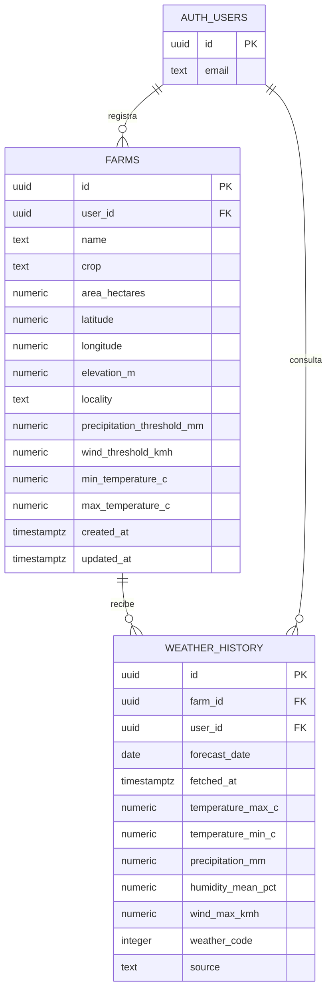

# Modelo de datos AgroClima

Las tablas agrícolas nuevas comparten el proyecto Supabase con el sistema que antes ocupaba este repositorio. La migración agrega las tablas AgroClima y no elimina ni cambia las tablas anteriores.

## Relaciones y reglas

- Cada terreno pertenece a una cuenta de Supabase Auth. Al borrar una cuenta, sus terrenos e historial se eliminan en cascada.
- Cada fila del historial apunta a un terreno. Al borrar un terreno, sus consultas asociadas se eliminan en cascada.
- Los campos numéricos tienen límites y restricciones para rechazar coordenadas o superficies inválidas.
- Los umbrales viven en `farms`; modificar un terreno no cambia su historial previo.
- Una consulta guarda una fila por cada fecha del pronóstico de siete días. `fetched_at` permite distinguir una consulta nueva de pronósticos anteriores.
- La humedad se guarda como promedio de las observaciones horarias de Open-Meteo dentro de cada día, con `null` si la API no devuelve esas observaciones.
- `farms.elevation_m` guarda la altitud aproximada en metros sobre el nivel del mar que devuelve la Elevation API de Open-Meteo (Copernicus DEM GLO-90); el usuario puede corregirla.

## Seguridad

RLS está habilitado en ambas tablas. Las políticas permiten a una cuenta leer, crear, actualizar y eliminar solo sus terrenos. El historial permite lectura e inserción solo cuando `user_id` coincide con la sesión autenticada y el terreno relacionado también le pertenece. El rol `anon` no recibe permisos de tabla.

La clave `sb_publishable_...` del cliente es pública por diseño. No se coloca `service_role` en GitHub Pages. La seguridad de los datos depende de RLS y de las restricciones de PostgreSQL, no de los filtros visuales del navegador.
