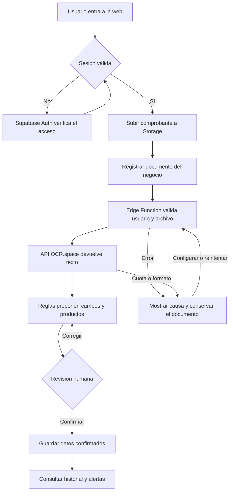
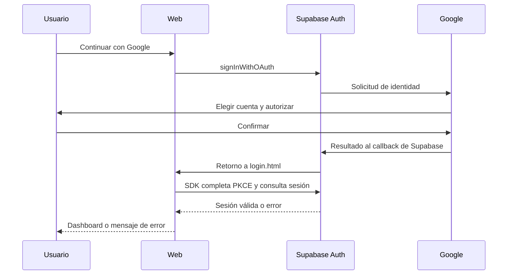

# CompraSmart AI: preparación según la rúbrica

Referencia: «Rubrica Pract Laboratorio 2 SI (1).pdf», entregada por el grupo. La rúbrica suma 20 puntos base; admite hasta 3 puntos adicionales, con nota final máxima de 20. Esta guía organiza el trabajo y la exposición; no asigna ni garantiza una calificación.

## Qué debe quedar demostrado

| Criterio | Puntos | Evidencia que debe mostrar cada integrante | Estado real |
| --- | ---: | --- | --- |
| Identificación del problema | 3 | Problema, usuario beneficiado y valor aportado. | Explicación preparada abajo. |
| Funcionamiento de la solución | 4 | Entrar, cargar un comprobante, procesarlo, revisar sus datos, guardar y recuperar la información. | Funciones desplegadas, guardado probado y registros operativos de OCR observados en el proyecto; cada integrante debe repetir la demostración. |
| Comprensión e integración tecnológica | 6 | Mostrar qué envía el navegador, qué ejecuta el servidor, dónde se guarda y cómo responde la API. | OCR.space conectado a process-invoice; explicar borrador, reserva de intentos, confirmación transaccional e historial. |
| Autenticación | 3 | Login real con una cuenta, persistencia y cierre de sesión. Explicar por qué una contraseña incorrecta no permite entrar. | Código existente revisado y pruebas locales de flujo; falta validación con cuentas reales del proyecto. |
| Sustentación y dominio | 4 | Explicar decisiones, límites, errores y participación de la IA. | Preguntas y respuestas preparadas abajo. |

### Puntos adicionales

| Función adicional | Puntos | Qué falta para demostrarla |
| --- | ---: | --- |
| Registro desde la aplicación | +1 | Probar registro, recepción y confirmación del correo en el proyecto real. El retorno a `login.html` ya está preparado. |
| Inicio de sesión con Google | +1 | Activar OAuth en Supabase y Google Cloud y probar el recorrido completo. La llamada a `signInWithOAuth` está implementada en la rama de recuperación; no equivale a un login real ya verificado. |
| RLS en Supabase | +1 | Prueba real aprobada con dos identidades y datos ficticios revertidos: aislamiento, relaciones, bóveda y confirmación. Mostrar también la separación entre dos cuentas en la demostración del grupo. |

Scraping, múltiples LLM, Sheets, Excel y automatizaciones forman parte de la ampliación solicitada en el documento maestro, pero no son criterios obligatorios de esta rúbrica. Se conservan como trabajo posterior al circuito principal y no deben impedir demostrar correctamente el login, los datos y el OCR.

## 1. Explicación del problema

> Un dueño de bodega recibe facturas de distintos proveedores y registra sus compras manualmente. Esto dificulta encontrar documentos y comparar cuánto pagó por el mismo producto. CompraSmart AI busca organizar esos comprobantes, reducir la transcripción manual con una API de OCR y consultar referencias de compras anteriores. El beneficiario es el comerciante; el valor es ahorrar tiempo y contar con información verificable antes de comprar nuevamente.

No afirmar que conocemos todos los precios del mercado. Las referencias disponibles son compras registradas por el negocio, con fecha, presentación, unidad y moneda. Tampoco prometer un ahorro o una precisión que no se haya medido.

## 2. Arquitectura que debe entender el grupo

| Parte | Herramienta | Responsabilidad |
| --- | --- | --- |
| Frontend | HTML, CSS y JavaScript | Formularios, carga de archivos, revisión, tablas y gráficos. |
| Código y web | GitHub y GitHub Pages | Colaboración y alojamiento estático. Pages no ejecuta las funciones de servidor. |
| Identidad | Supabase Auth | Registro, comprobación de credenciales, sesiones y OAuth. |
| Archivos | Supabase Storage, bucket `invoices` | Guardar el comprobante y abrirlo mediante una URL temporal autorizada. |
| Backend | Supabase Edge Functions | Validar la sesión, recuperar la clave del servidor y comunicarse con proveedores. |
| OCR | OCR.space, motor 2 | Recibir una imagen o PDF permitido y devolver texto mediante una API HTTP. |
| Estructuración | Reglas de extracción | Proponer proveedor, RUC, fecha, número, cantidades, unidades e importes y advertir inconsistencias. |
| Datos | PostgreSQL de Supabase | Negocios, comprobantes, catálogo, proveedores e historial. |
| Protección | RLS y validaciones de servidor | Restringir operaciones a los datos autorizados y validar las relaciones. La prueba SQL con dos identidades ya pasó. |
| Visualización | Chart.js | Dibujar gráficos a partir de datos consultados. Los cálculos se mantienen separados por moneda. |

### Flujo objetivo que debe verificarse antes de exponer

El código de este circuito ya está implementado y ambas funciones están desplegadas. Las partes se comprobaron con pruebas automáticas, llamada real a OCR.space y SQL real. Falta demostrar el recorrido completo desde la web con una cuenta y la clave del grupo; no presentar esa prueba interactiva como ya ejecutada.

### Qué viaja por cada conexión

1. El navegador utiliza la URL del proyecto y la clave **publicable**. Esa clave identifica el proyecto y no concede acceso administrativo.
2. Al iniciar sesión, Supabase devuelve una sesión al SDK. En una llamada de usuario a una función, el SDK envía el token de sesión en `Authorization`.
3. El archivo se carga en Storage y su ruta queda asociada al comprobante, usuario y negocio. Una ruta del navegador no sustituye la autorización del servidor.
4. La función recupera y valida el documento autorizado y realiza el POST al proveedor OCR. La clave privada del proveedor permanece en el servidor.
5. OCR.space devuelve JSON con texto reconocido. Las reglas organizan lo reconocible y mantienen advertencias sobre lo desconocido; no completan precios inventados.
6. Al confirmar, el navegador llama a confirm_invoice_data. PostgreSQL valida y guarda factura, proveedor, productos, líneas e historial en una transacción dentro del negocio. Un error revierte toda la operación y un segundo clic no la duplica.
7. Los gráficos se calculan desde los registros consultados. PEN y USD se muestran por separado, sin una conversión cambiaria implícita.

Al mostrar Network en clase, enseñar URL, estado y formato de la respuesta. Evitar mostrar contraseñas, tokens `Authorization`, Client Secret o claves privadas.

## 3. Cómo explicar el login

### Correo y contraseña

El formulario llama a `supabase.auth.signInWithPassword`. La contraseña se comprueba en Supabase Auth. La aplicación solo considera exitoso el acceso cuando el servidor devuelve usuario y sesión. El SDK gestiona su persistencia y renovación según la configuración del proyecto; `persistSession: true` mantiene la sesión en este navegador.

La aplicación utiliza `getUser()` para identificar al usuario del dashboard. El cliente no puede autorizarse a leer datos ajenos enviando otro `user_id`: esa restricción debe imponerse también mediante RLS y las validaciones del servidor.

Cerrar sesión llama al SDK y regresa a `login.html`; no elimina las facturas. La casilla antigua de mantener sesión no estaba conectada a ninguna lógica: se sustituyó por una explicación del comportamiento real de la sesión.

### Google: identidad externa, independiente del OCR

El cliente ya utiliza PKCE y detección de sesión en URL. La versión fijada del SDK realiza el intercambio del código en su inicialización; no se agrega un segundo intercambio manual. Si se cancela el acceso o Google no está habilitado, se muestra un mensaje y se conserva la posibilidad de usar correo.

Google Login no requiere llamar a Gemini. Tampoco autoriza por sí mismo el acceso a Sheets o Drive; esta versión no solicita esos permisos adicionales.

## 4. Demostración sugerida

El tiempo de exposición no está fijado en el PDF. Adaptar este orden al tiempo asignado por el profesor:

1. Explicar el problema y quién se beneficia.
2. Entrar con una cuenta real de prueba. Mostrar también el rechazo de una contraseña incorrecta, sin exponerla.
3. Subir `tests/fixtures/receipt-demo.png`, marcado como ficticio y sin validez. Explicar dónde queda el archivo y qué solicita el navegador al backend.
4. Ejecutar el procesamiento conectado a la API real. Mostrar el texto y los campos obtenidos; revisar total, unidades, fecha y cualquier advertencia.
5. Confirmar y recuperar la compra desde el historial; recargar para comprobar persistencia. Este recorrido debe verificarse antes de presentarlo como operativo.
6. Mostrar los gráficos e indicar qué representan: gasto por moneda, cantidad de productos por categoría y cantidad de comprobantes por estado.
7. Para comparar precios, usar registros controlados del mismo producto, presentación, unidad y moneda, con fechas de los últimos 30 días. Identificar proveedor y fecha; no anunciar disponibilidad.
8. Cerrar sesión y comprobar que no continúa el acceso a datos privados desde la aplicación.
9. Si se habilitan los extras, demostrar registro, Google Login y aislamiento entre dos cuentas.

La prueba manual aislada del adaptador puede ejecutarse con `node scripts/probe-ocr.mjs --public-demo`. Es una evidencia de llamada real al proveedor, pero no reemplaza la demostración completa desde la web y Supabase del grupo.

## 5. Evidencias mínimas para cerrar el proyecto

| Evidencia | Criterio relacionado | Comprobación |
| --- | --- | --- |
| Descripción del problema y del usuario | Problema | La solución presentada corresponde a la necesidad descrita. |
| URL publicada del repositorio del grupo | Funcionamiento | La web carga en otro navegador y muestra los cambios subidos. |
| Foto ficticia y resultado de OCR | Funcionamiento e integración | La respuesta corresponde al archivo; no se simula éxito. |
| Registro confirmado e historial tras recargar | Funcionamiento | Los datos persisten en el Supabase correcto. |
| Captura o explicación de solicitudes | Integración | Distinguir frontend, Auth, Storage, función y proveedor externo. |
| Login, error y cierre de sesión reales | Autenticación | El servidor valida la cuenta y se gestiona la sesión. |
| Dos usuarios con datos de prueba distintos | RLS adicional | A no puede leer ni modificar los registros de B. |
| Registro y Google completos | Adicionales | No basta un botón ni una respuesta simulada. |

## 6. Preguntas que todos deben poder responder

**¿Dónde está la IA?** Se utilizó IA para apoyar el desarrollo, revisión y preparación de pruebas. En ejecución, un servicio de OCR reconoce texto de documentos. La estructuración y los cálculos que hemos programado son reglas; no afirmamos que todo sea un modelo generativo.

**¿Qué es una API?** Es una interfaz para enviar una solicitud con un formato definido y recibir una respuesta. Aquí el backend envía un archivo al endpoint de OCR.space y recibe JSON con texto reconocido.

**¿Qué diferencia hay entre OCR y extraer campos?** El OCR convierte imagen en texto. Las reglas intentan reconocer qué parte es fecha, RUC, producto o importe. Una lectura de texto correcta no garantiza que se hayan identificado todas las filas.

**¿Por qué necesitamos backend si la web está en GitHub?** El backend ejecuta las operaciones de servidor, comprueba permisos y utiliza la clave privada del proveedor. GitHub Pages aloja los archivos estáticos.

**¿Por qué puede verse la clave publicable?** Está diseñada para el cliente. La protección depende de la sesión, RLS y permisos; una clave de proveedor, una contraseña y `service_role` no son claves publicables.

**¿Guardar una API Key significa que funciona?** No. Guardarla prueba almacenamiento. Verificar conexión exige una respuesta válida del proveedor. La interfaz diferencia configurada de verificada.

**¿Cómo se protegen las claves existentes?** Se conserva el cifrado AES-256-GCM y su clave maestra del servidor. El navegador recibe metadatos, no la clave descifrada. Dejar el campo vacío no borra el secreto.

**¿Qué es RLS?** Son políticas de PostgreSQL que restringen las filas que puede leer o modificar cada rol y usuario. Filtrar un listado en JavaScript no reemplaza esa protección.

**¿Cómo comprobamos RLS?** Primero se confirma que B tiene un registro propio. Luego, con la sesión de A, se intenta acceder a ese identificador y modificarlo. Debe denegarse o no devolver filas. Una tabla vacía no prueba aislamiento.

**¿Qué ocurre si la API devuelve 429 o una foto es borrosa?** Se muestra el límite o el fallo de lectura y se solicita reintento o revisión. No se marca como procesado un documento que falló. El plan gratuito tiene cuotas.

**¿De dónde sale el precio de referencia?** Del historial autorizado, con una referencia reciente por proveedor y moneda. No representa automáticamente todo el mercado ni confirma stock.

**¿Cómo se calculan los gráficos?** Solo se suman importes de documentos procesados y se agrupan por moneda. La dona actual cuenta productos por categoría; no se presenta ese conteo como gasto monetario.

**¿Qué construyó la IA y qué comprende el grupo?** Explicar las funciones y pruebas concretas que se revisaron: autenticación, carga, API, parser, persistencia, permisos y métricas. Cada integrante debe recorrer el flujo; no se exige memorizar el código.

## 7. Límites que se deben reconocer

El acceso a Supabase ya funciona y las pruebas reales de RLS y confirmación pasaron. Falta la demostración interactiva con la clave del grupo y sus cuentas. Google continúa deshabilitado en la configuración pública de Auth: su código no certifica que Google Cloud esté configurado. OCR.space sí está conectado a la función desplegada; la clave pública de demostración no se guarda en producción.

El parser reconoce algunas filas impresas con cantidad, descripción y dos importes al final. Las unidades desconocidas y discrepancias se marcan para revisión; no se garantiza cualquier formato de factura. Los PDFs y archivos están sujetos a los límites del proveedor gratuito.

No presentar como terminados scraping, automatizaciones, Sheets, Excel, consentimiento legal persistente ni capacidades que solo se hayan descrito o dibujado.

## Referencias de implementación

- Rúbrica original entregada por el grupo.
- Google con Supabase Auth: https://supabase.com/docs/guides/auth/social-sign-in/auth-google
- Redirecciones de Auth: https://supabase.com/docs/guides/auth/redirect-urls
- API OCR.space: https://ocr.space/ocrapi
- Código y pruebas del grupo en este repositorio; estado de accesos en `ACCESOS_Y_CIERRE.md`.
